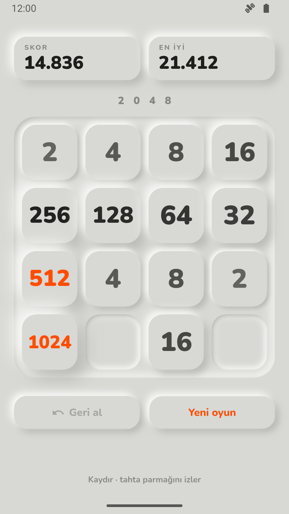
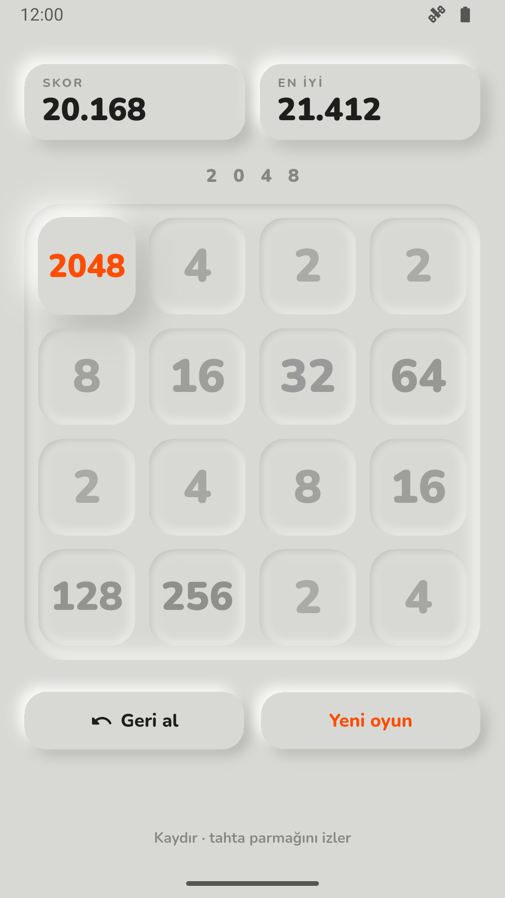
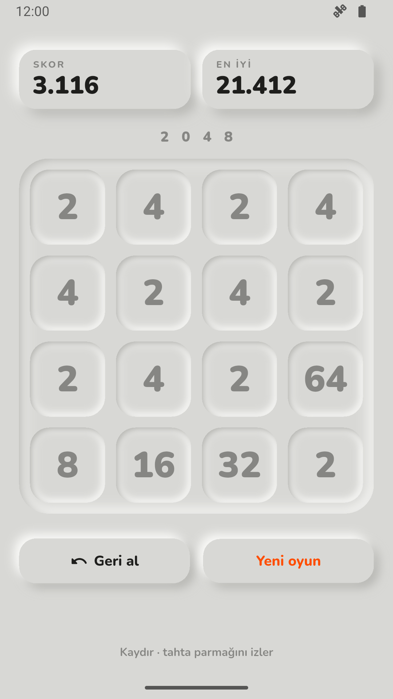

# 2048
### Part 08 · Her Hafta 1 Uygulama

Kısa bir mola veren biri için internetsiz, reklamsız, iki dakikalık bir
bulmaca. Kareler kil gibi kabarık; geri al tuşu son 20 hamleye kadar gidiyor.

**Kod:** [github.com/MRGNSs11/weekly-flutter-apps-1](https://github.com/MRGNSs11/weekly-flutter-apps-1/tree/main/part08-2048) · **Yığın:** Flutter, Riverpod, shared_preferences, CustomPainter

---

## 01 — Ne yaptım

Tek ekran. Tahtayı kaydırıyorsun, aynı sayılar birleşiyor, skor artıyor.
Yanlış hamlede geri alıyorsun. 2048 olunca kazanan kare kabarıp turuncu
oluyor, ötekiler sönüyor. Hamle kalmayınca kareler satır satır içe çöküp
griye dönüyor. Uygulama kapanırsa oyun kaldığı yerden açılıyor.

## 02 — Neyi YAPMADIM

- Tahta boyutu seçimi (3×3, 5×5)
- Çevrimiçi liderlik tablosu
- Tema seçici, istatistik ekranı
- Ses ve titreşim
- Reklam ve satın alma

Bu hafta gösterilecek şey oyunun kendisi değil, durumun nasıl tutulduğuydu.
Her ek ekran bunu gölgede bırakırdı.

## 03 — Bu hafta gösterdiğim teknik yetenek

**Riverpod ile tek kaynaktan yönetilen, hiç değiştirilmeyen oyun durumu.**
Seride state yönetimi ilk kez ana yetenek. Kurallar Flutter'a dokunmayan saf
Dart ([`kurallar.dart`](lib/oyun/kurallar.dart)): kaydır, birleştir, yeni kare,
oyun sonu. Ekran yalnız bir `Notifier`'ı okuyor
([`oyun_notifier.dart`](lib/oyun/oyun_notifier.dart)). Riverpod, durumu
ekrandan ayrı tutan bir kütüphane; böylece oyun ekran kurmadan test ediliyor.
Rastgelelik de dışarıdan veriliyor: testte sabit tohumla "rastgele" kare her
seferinde aynı yere düşüyor.

## 04 — Aldığım karar

**Neden geri al için ayrı kod yazmadım?**

Geri alın klasik yolu her hamlenin tersini hesaplamak: hangi kare nereden
geldi, hangisi birleşti, skor ne kadar düşecek. Her kuralın bir de tersini
yazmak, hata için iki kat yer demek.

Ben durumu hiç değiştirmemeyi seçtim. Her hamle eski durumu bozmadan yenisini
üretiyor. O zaman geçmiş, eski durumların listesi; geri al da sondakini geri
koymak. Test bunu doğrudan sınıyor: geri alınan durum, hamleden önceki durumla
aynı nesne. Bedeli bellek: 20 tahta tutuluyor, ama her biri 16 sayı.

Yarım oyun kaydı da aynı fikirden çıktı: tek bir durumu diske yazmak yetti.

## 05 — Nasıl doğruladım

72 test: kurallar (23), bozuk kayıt dahil kaydetme (21), Notifier (15),
widget (8), depo (5). Widget testleri tahtanın gerçekten eğildiğini ve geri
alınca grileştiğini ölçüyor. Cihazda bir entegrasyon testi gerçek kaydırmalarla
oynuyor ve uygulamayı kapatıp açıyor. Release derlemesinde hiç izin yok.

Animasyonların güzelliğini test etmedim; onu telefonda gözle denedim.

## 06 — Ne öğrendim

**Testler geçince iş bitmiyor, telefonda da denemek gerekiyor.** İlk sürüm
gerçek telefonda takılıyordu. Sebebi kabarık görünümün iç gölgesiydi: delikli
bir şekli bulanıklaştırarak çiziyordum, bu her seferinde yüzeyin 9 katı alanı
bulanıklaştırmak demekti. Aynı görüntüyü üç yuvarlak dikdörtgen bulanıklığıyla
çizince ekran kartı hızlı yoldan çizdi ve takılma bitti.

---
Bu, her hafta bir mobil uygulama bitirdiğim serinin 8. uygulaması.
Diğerleri: [github.com/MRGNSs11/weekly-flutter-apps-1](https://github.com/MRGNSs11/weekly-flutter-apps-1)
