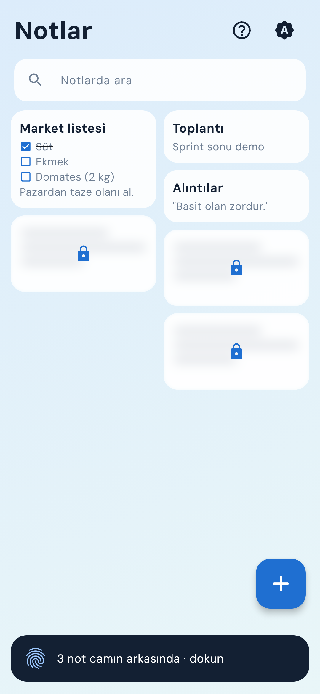
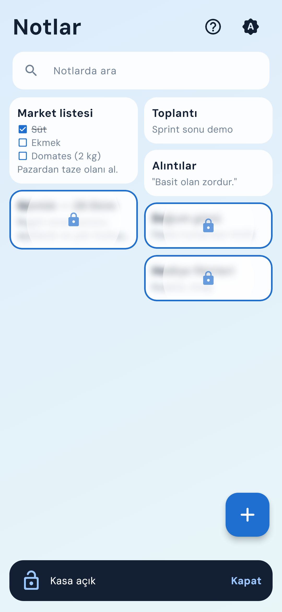
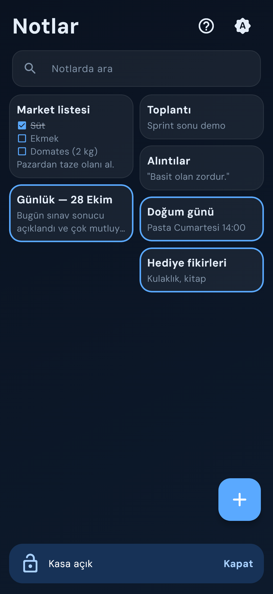
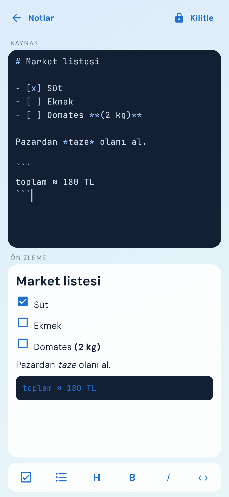
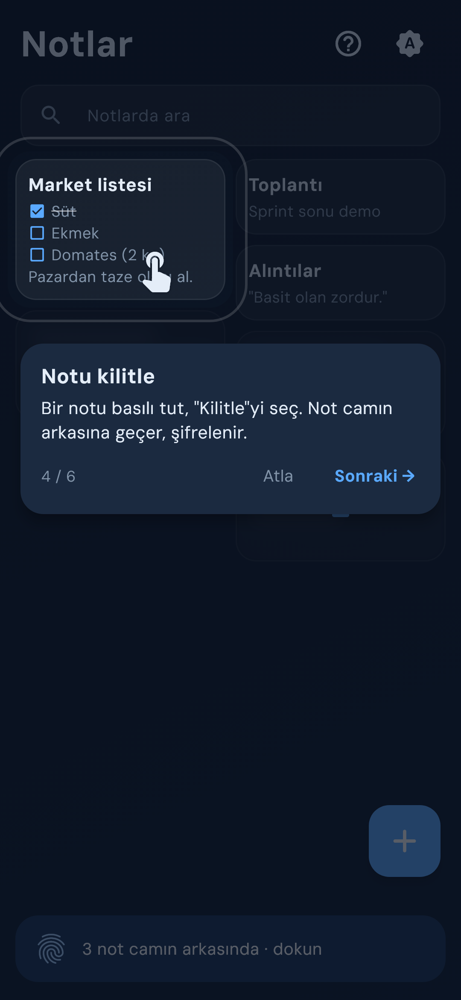

# Part 10 — Notlar

Normal bir Markdown not defteri; istediğin notu kilitleyince not buzlu camın
arkasına geçiyor ve yalnız parmak izinle açılıyor. Yazarken üstte kaynak, altta
canlı önizleme var; kaydet düğmesi yok. İnternet yok, reklam yok.
"Her hafta 1 uygulama" serisinin onuncu parçası.

**Gösterilen yetenek:** Biyometrik kilit. Kilitli notlar AES-256-GCM ile
şifreleniyor; şifreyi çözen anahtar telefonun güvenli bölgesinde duruyor ve
yalnız parmak izi (ya da ekran kilidi) doğrulanınca dışarı çıkıyor.







## Çalıştırma

Anahtar, hesap ya da ayar dosyası gerekmiyor:

```bash
flutter pub get
flutter run
```

**Yalnız Android.** Kasa için telefonda ekran kilidi (PIN, desen ya da parmak
izi) açık olmalı; yoksa notlar yine yazılıyor, yalnız kilitleme kapalı.

## Parmak izi bir kapı değil, anahtar

En kolay yol, kasayı açarken `local_auth` ile "parmak izi doğru mu?" diye
sormak ve evet gelirse notları göstermek. Bu bir kapı: notlar diskte yine düz
metin, kapı yalnız ekranı koruyor.

Notlar'da parmak izi doğrudan **anahtarı** açıyor:

1. İlk kilitlemede 32 baytlık rastgele bir anahtar üretiliyor ve
   `flutter_secure_storage` ile Android Keystore'a, kullanıcı doğrulamasına
   bağlı olarak yazılıyor
   ([`yerel_kasa_servisi.dart`](lib/kasa/yerel_kasa_servisi.dart)).
2. Kilitli notun metni bu anahtarla AES-256-GCM ile şifreleniyor; veritabanında
   `icerik` sütunu boşalıyor, yalnız şifreli baytlar kalıyor
   ([`sifreleme.dart`](lib/kasa/sifreleme.dart)). Notun başlığı da metnin ilk
   satırı olduğu için o da şifreli.
3. Kasa açılırken anahtar okunuyor; Keystore okumadan önce parmak izi istiyor.
   Anahtar yalnız kasa açıkken bellekte duruyor
   ([`kasa_kontrol.dart`](lib/uygulama/kasa_kontrol.dart)).

`local_auth` yine var ama işi küçük: telefonda ekran kilidi var mı diye bakmak.

### Kullanılan ayarlar

| Ayar | Değer | Etkisi |
|---|---|---|
| `enforceBiometrics` | `true` | Ekran kilidi olmayan telefonda anahtar üretilmez; kasa kapalı kalır |
| `requireBiometricsPerOperation` | `true` | Kasa her açılışta yeniden parmak izi ister |
| `resetOnError` | `false` | Okuma hatasında veri silinmez; uygulama nedenini gösterir |

Anahtarın ilk üretildiği oturumda kasa açılırken ayrıca `local_auth` ile parmak
izi isteniyor; uygulama yeniden başlayınca buna gerek kalmıyor.

Telefona yeni bir parmak izi eklenirse Android anahtarı geçersiz sayıyor
(`setInvalidatedByBiometricEnrollment`). Bu durumda kilitli notlar açılamıyor;
uygulama çökmüyor, şeritte nedenini yazıyor.

## Kasa ne zaman kapanıyor?

| Olay | Kasa |
|---|---|
| Uygulama arka plana geçti (`hidden` / `paused`) | Kapanır |
| Parmak izi penceresi açıldı, bildirim perdesi çekildi (`inactive`) | Açık kalır |
| Şeritteki **Kapat** | Kapanır |

Kapanmadan önce açık düzenleyicideki bekleyen değişiklik şifrelenip yazılıyor,
anahtar ondan sonra siliniyor. Kasa açıkken son uygulamalar ekranında
uygulamanın önizlemesi gizleniyor (`setRecentsScreenshotEnabled(false)`,
Android 13+). `FLAG_SECURE` kullanmadım: o, ekran görüntüsünü de engelliyor.

## Düzenleyici

- **Kaynak + canlı önizleme** aynı anda; Markdown işaretleri kaynakta renkli.
- **Kaydet düğmesi yok:** yazmayı bırakınca 2 sn sonra, geri tuşunda ve
  uygulama arka plana geçince kaydediliyor. Kayıtlar sıraya alınıyor; aynı anda
  iki kayıt gelince yeni not iki kez eklenmiyor.
- **Araç çubuğu** (☑ · • · H · B · I · ‹›): telefon klavyesinde `[ ]`, `#`,
  `*` yazmak zahmetli olduğu için.
- **Enter ile liste devamı:** görev satırında Enter alt satırı `- [ ] ` ile
  başlatıyor, boş maddede Enter listeyi bitiriyor
  ([`bicim.dart`](lib/alan/bicim.dart)).
- **Önizlemedeki kutuya dokununca** kaynaktaki aynı sıradaki `- [ ]`
  değişiyor; kod bloğunun içindekiler sayılmıyor
  ([`gorev.dart`](lib/alan/gorev.dart)).

## Ekran: buğulu cam

Ayrı bir kasa bölümü yok: kilitli notlar ızgarada yerinde duruyor, buzlu camın
arkasında. Kasa kapalıyken camın arkasında gerçek metin yok, yalnız bulanık
çizgiler var (metin zaten şifreli, çözülmüyor).

| An | Animasyon |
|---|---|
| Parmak izi bekleniyor | Şeritteki parmak izi ikonu nabız gibi atıyor |
| Kasa açılıyor | Cam her kartın ortasından daire olarak küçülüyor, bulanıklık kalkıyor (700 ms) |
| İlk açılış rehberi | Ekran kararıyor, anlatılan düğme ışıkta kalıyor, bir el dokunma ya da basılı tutma hareketini gösteriyor |

Aydınlık ve karanlık tema var; uygulama içinden Sistem · Aydınlık · Karanlık
seçilebiliyor. Telefonda "animasyonları kaldır" açıksa cam anında açılıyor, el
duruyor.

## Veri ve izinler

| Konu | Durum |
|---|---|
| Tutulan | Not metinleri (kilitliler şifreli), tema seçimi, rehberin görülüp görülmediği |
| Nerede | Drift (SQLite), uygulamanın kendi klasörü; kasa anahtarı Android Keystore'da |
| İzinler | `USE_BIOMETRIC`, `USE_FINGERPRINT` (paketlerden gelir) |
| İnternet | **Yok.** `INTERNET` izni bile yok |
| Dışarıya giden | Hiçbir şey |
| Yedek | `allowBackup` kapalı, cihazdan cihaza aktarım da kapalı (`dataExtractionRules`). Anahtar telefona bağlı olduğu için yedekten dönen kilitli not zaten açılamaz |

Doğrulama:

```bash
# release derlemesinden sonra: iki biyometrik izin + androidx'in uygulamaya
# özel iç izni; INTERNET yok
aapt dump permissions build/app/outputs/flutter-apk/app-release.apk
# allowBackup=0
aapt dump xmltree build/app/outputs/flutter-apk/app-release.apk AndroidManifest.xml | grep allowBackup
```

## Doğrulama

```bash
flutter analyze   # temiz
flutter test      # 57 test
```

| Dosya | Ne sınanıyor | Test |
|---|---|---|
| `alan_test.dart` | Başlık çıkarma, Türkçe arama (İ/ı), görev kutusu değiştirme (kod bloğu dahil) | 13 |
| `kasa_kontrol_test.dart` | İlk kilitleme, kapanınca belleğin temizlenmesi, ilk oturum ek doğrulaması, iptal, geçersiz anahtar, `inactive` ile `paused` farkı, kapanmadan önce kayıt | 10 |
| `bicim_test.dart` | Enter ile liste devamı, numaralı liste, boş maddede bitiş, araç çubuğu işlemleri | 9 |
| `duzenleyici_test.dart` | Canlı önizleme, 2 sn kayıt, önizlemeden görev işaretleme, boş not, araç çubuğu, Enter, tema kaydı | 7 |
| `not_deposu_test.dart` | Ekle, güncelle, sil, kilitlenen notun düz metninin veritabanında kalmaması (ham SQL), sıralama | 6 |
| `sifreleme_test.dart` | Şifrele-çöz, her seferinde yeni nonce, yanlış anahtar ve bozuk verinin hata vermesi | 5 |
| `rehber_test.dart` | İlk açılışta bir kez, ilerleme, hedef dışına dokunmanın etkisizliği, ? düğmesi | 4 |
| `liste_ekrani_test.dart` | Kasa kapalıyken başlıkların gizli olması, şeritten açılış, arama | 3 |

Kasa servisi soyut; testlerde sahte bir kasa kullanılıyor. Parmak izi
penceresini, Keystore'u ve son uygulamalar ekranını testler göremiyor; onları
gerçek telefonda (Samsung, Android 16) denedim.

## Paketler

`local_auth` · `flutter_secure_storage` · `cryptography` (+ `cryptography_flutter`) ·
`drift` · `flutter_markdown_plus`

`flutter_markdown` bırakıldı, devamı `flutter_markdown_plus`. Durum yönetimi
`ChangeNotifier`. Yazı tipleri (DM Sans, JetBrains Mono) dosya olarak gömülü
(`assets/fonts/`, OFL lisansları yanında). İkon `tool/ikon_uret.py` ile
üretiliyor.

## Bilinen sınırlar

- Yeni parmak izi eklenince kilitli notlar açılamıyor; kurtarma parolası yok.
- Yedekleme ve telefon değiştirince taşıma yok.
- Resim, klasör ve etiket yok.
- iOS derlemesi yok.
