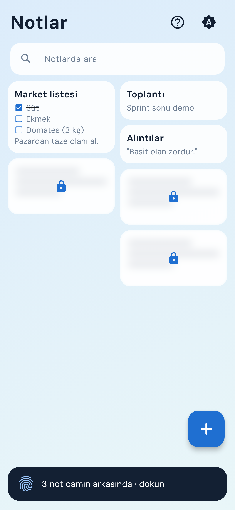
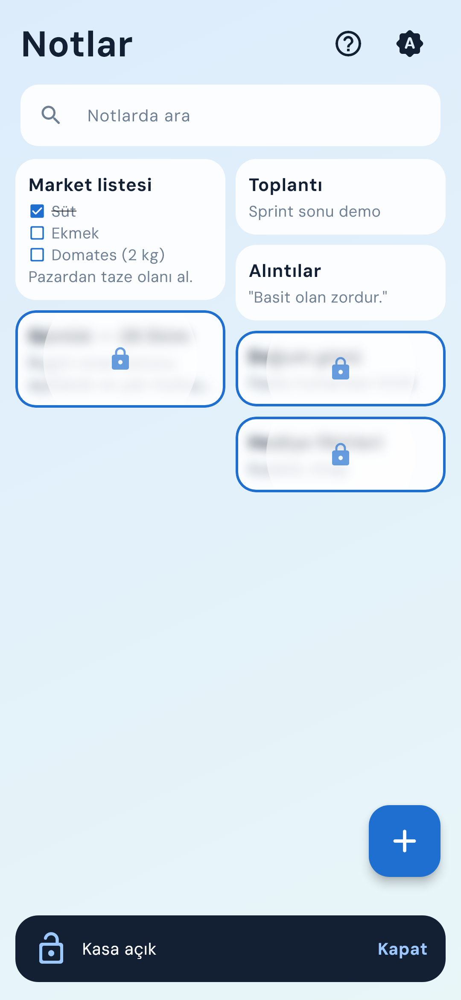
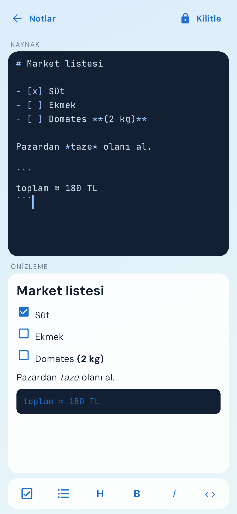

# Notlar
### Part 10 · Her Hafta 1 Uygulama

Not alan biri için, özel notları parmak izinin arkasında tutan bir Markdown
not defteri.

**Kod:** [github.com/MRGNSs11/weekly-flutter-apps-1](https://github.com/MRGNSs11/weekly-flutter-apps-1/tree/main/part10-kasa-not) · **Yığın:** Flutter, local_auth, flutter_secure_storage, cryptography (AES-GCM), Drift, flutter_markdown_plus

---

## 01 — Ne yaptım

Normal bir not defteri. Bir notu basılı tutup "Kilitle" deyince not buzlu
camın arkasına geçiyor. Alttaki şeride dokunup parmak izini okutunca cam her
kartta daire olarak çekiliyor. Uygulamadan çıkınca kasa kendiliğinden
kapanıyor. Not yazarken üstte Markdown kaynağı, altta canlı önizleme var;
kaydet düğmesi yok. İlk açılışta kısa bir rehber neyin nerede olduğunu
gösteriyor.

## 02 — Neyi YAPMADIM

- Bulut senkronu ve yedek
- Kurtarma parolası
- Resim, klasör, etiket
- Ekran görüntüsü engeli
- iOS

Bu haftanın konusu kilitti. Senkron eklesem anahtarın telefondan çıkması
gerekirdi; bu da asıl fikri bozardı.

## 03 — Bu hafta gösterdiğim teknik yetenek

**Biyometrik kilit ve şifreleme.** Kilitli notun metni AES-256-GCM ile
şifreleniyor ([`sifreleme.dart`](lib/kasa/sifreleme.dart)). Anahtar Android
Keystore'da, kullanıcı doğrulamasına bağlı duruyor; parmak izi okutulmadan
dışarı çıkmıyor. Kasa açıkken anahtar bellekte, kapanınca siliniyor. Kasa
açıkken son uygulamalar ekranında önizleme gizleniyor.

## 04 — Aldığım karar

**Neden yalnız local_auth değil?**

En kolay yol `local_auth` ile "parmak izi doğru mu?" diye sorup evet gelince
notları göstermek. Ama bu bir kapı: notlar diskte düz metin kalıyor, kapı
yalnız ekranı koruyor.

Ben parmak izini kapı değil anahtar yaptım. Şifre çözme anahtarı
`flutter_secure_storage` ile Keystore'a doğrulamaya bağlı yazılıyor; okumak
için parmak izi gerekiyor. Veritabanında kilitli notun metni yok, yalnız
şifreli baytlar var. Bedeli: telefona yeni parmak izi eklenince Android
anahtarı geçersiz sayıyor ve kilitli notlar açılamıyor. Uygulama bunu çökmeden
söylüyor.

## 05 — Nasıl doğruladım

57 test: arama ve görev kutusu (13), kasa kontrolü (10), liste devamı ve araç
çubuğu (9), düzenleyici (7), veritabanı (6), şifreleme (5), rehber (4),
liste ekranı (3). Bir test veritabanına doğrudan SQL ile bakıp kilitli notun
metninin orada olmadığını doğruluyor. Kasa servisi soyut; testte sahte kasa
kullanılıyor.

Parmak izi penceresini ve Keystore'u testler göremiyor. Kodlamaya başlamadan
önce küçük bir deneme uygulamasıyla bunları gerçek telefonda (Samsung,
Android 16) denedim.

## 06 — Ne öğrendim

**Riskli kısmı önce dene.** Ekranları planlamadan önce, yalnız parmak izinin,
anahtarın ve son uygulamalar ekranının gerçek telefonda nasıl davrandığını
görmek için tek ekranlık bir deneme uygulaması yaptım. Plan değişti: paketin
iki ayarı değişmeliydi, ilk açılıştaki bir durum da ek bir parmak izi
doğrulaması istedi. Bunu ekranlar bittikten sonra öğrenseydim ekranları yeniden
yazmam gerekirdi.

---
Bu, her hafta bir mobil uygulama bitirdiğim serinin 10. uygulaması.
Diğerleri: [github.com/MRGNSs11/weekly-flutter-apps-1](https://github.com/MRGNSs11/weekly-flutter-apps-1)
