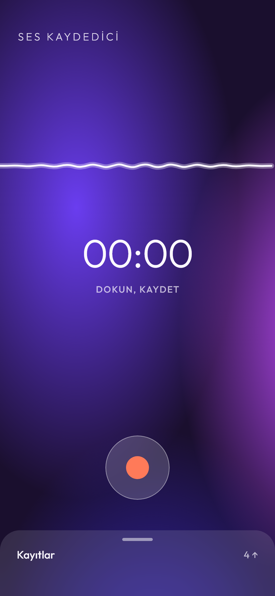
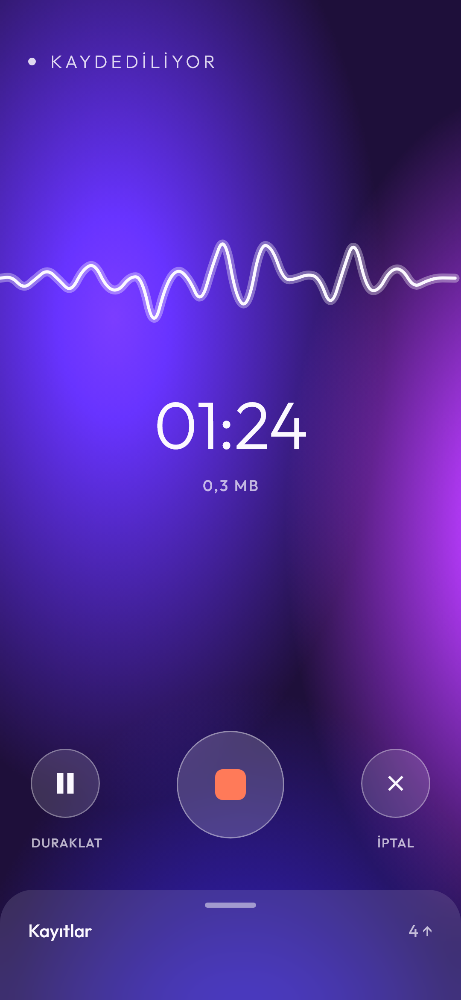
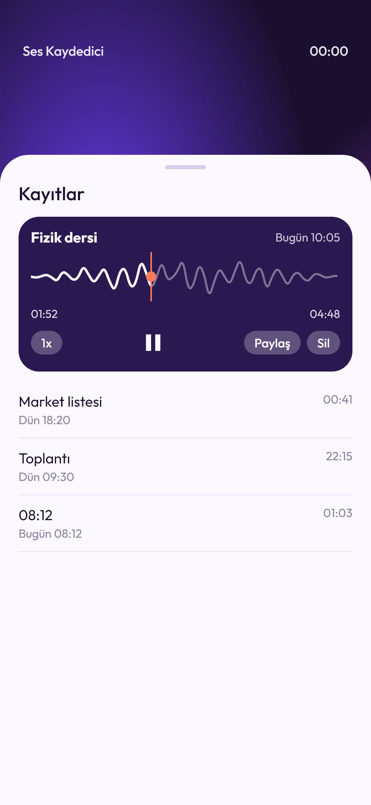
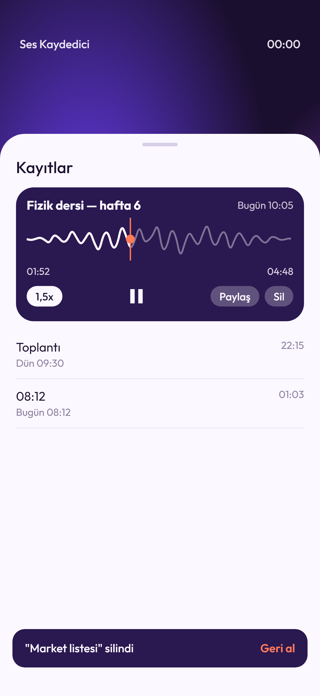
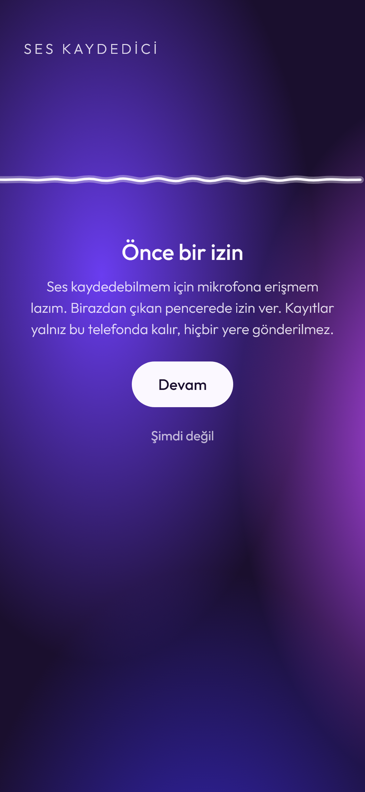

# Part 11 — Ses Kaydedici

Kaydederken ses tek bir beyaz
çizgi olarak titriyor, arkada mor bir bulut akıyor. Ekran kapalıyken de kayıt
sürüyor. Kayıtlar alttan çekilen sayfada; dinlerken dalgaya dokunup istediğin
yere atlıyorsun. "Her hafta 1 uygulama" serisinin on birinci parçası.

**Gösterilen yetenek:** Mikrofon kaydı + canlı ses seviyesi, ekran kapalıyken
kayıt için kendi yazdığım mikrofon tipi ön plan servisi (Kotlin).







## Çalıştırma

Anahtar, hesap ya da ayar dosyası gerekmiyor:

```bash
flutter pub get
flutter run
```

**Yalnız Android** (Android 10 ve üstü; Opus kaydı bunu istiyor).

## Dalgayı dosyadan çözmüyorum, kayıt sırasında saklıyorum

Ses kaydedicilerde dinleme ekranındaki dalga genelde ses dosyası çözülerek
çiziliyor. Bunu yapan hazır paket (`audio_waveforms`) Android'de açık ve ciddi
hatalar taşıyordu: `stop()` bitmiyor, dosya bozuluyor, süre iki katı çıkıyor.

Ben başka yoldan gittim:

1. Kaydı `record` paketi yapıyor; 50 ms'de bir ses seviyesini (dBFS) veriyor
   ([`kaydedici.dart`](lib/uygulama/kaydedici.dart)).
2. Gelen her seviye 0..1 arasına çevrilip bir listeye ekleniyor
   ([`seviye.dart`](lib/alan/seviye.dart)). Kayıt ekranındaki titreyen çizgi
   bu listenin son 40 değeri.
3. Kayıt bitince liste, örnek başına 1 bayt olarak kayıtla birlikte veritabanına
   yazılıyor; bir saatlik kayıt ~72 KB ([`dalga.dart`](lib/alan/dalga.dart)).
4. Oynatıcı dalgayı bu listeden çiziyor. Ekrana sığdırırken her parçanın **en
   yüksek** değeri alınıyor; ortalama alınsa kısa bir öksürük ya da vurgu
   kaybolurdu.

Dosya hiç çözülmüyor; dalga anında hazır.

## Ekran kapalıyken kayıt

Android, ekran kapanınca arka plandaki uygulamanın mikrofonu kullanmasına
izin vermiyor. İzin vermesi için uygulamanın görünür bir "çalışıyorum"
bildirimi tutan, **mikrofon tipinde** bir ön plan servisi açması gerekiyor.

`record` paketi kendi servisini kurmuyor; servisi Kotlin'de kendim yazdım
([`KayitServisi.kt`](android/app/src/main/kotlin/com/omergunes/ses_kaydedici/KayitServisi.kt)).
Servisin işi küçük: "Kaydediliyor" bildirimini göstermek ve işlemci uyumasın
diye kısmi uyanık tutma almak. Kaydı yine `record` yapıyor. Dart ile servis
arasında `seskaydedici/servis` kanalı var.

| Olay | Ne oluyor |
|---|---|
| Ekran kapandı, başka uygulamaya geçildi | Kayıt sürüyor (telefonda denendi, ses ve süre tam) |
| Bildirimdeki **Durdur** | Kayıt bitiyor, listeye düşüyor; uygulamayı açmak gerekmiyor |
| Telefon geldi | Mikrofon kendiliğinden duraklıyor, ekran "Duraklatıldı"ya geçiyor; Devam ile sürüyor |
| Bildirim izni reddedildi | Kayıt yine sürüyor, yalnız bildirim görünmüyor |

## Kayıt ve dinleme

- **Kayıt:** Opus, 32 kbps, mono; dakikası yaklaşık 0,25 MB. Duraklat, devam,
  iptal (dosya silinir, listeye yazılmaz).
- **Mikrofon izni:** Android'in penceresinden önce kısa bir açıklama çıkıyor.
  İzin verilince kayıt hemen başlıyor; reddedilince ayarlara götüren bir ekran.
- **Oynatıcı** (`just_audio`): dalgaya dokun ya da sürükle = o ana sar; hız
  1x → 1,5x → 2x; ada dokununca yeniden adlandır.
- **Sil:** kayıt hemen listeden düşüyor, 5 sn boyunca **Geri al** var. Süre
  dolunca ses dosyası da siliniyor.
- **Paylaş:** Android paylaş menüsü; dosya kaydın adıyla gidiyor
  (`6 Kas 14.32.ogg`).

## Ekran: akan renk

| Parça | Nasıl |
|---|---|
| Mor bulut | Üç radyal gradyan; 12 sn'de bir ileri-geri kayıyor. Kayıtta 3 sn'ye iniyor ve parlıyor. Paket yok, `CustomPainter` |
| Ses çizgisi | Tek beyaz Bezier eğrisi; iki ucu sabit, ortası en çok oynuyor |
| Cam düğmeler | `BackdropFilter` ile buzlu cam; kayıt düğmesinin içi daireden kareye dönüyor |
| Kayıtlar | Alttan çekilen sayfa; sürükle, dokun ya da geri tuşuyla kapanıyor |

Renkler 60-30-10: mor bulut zemin, lila beyaz yüzeyler, tek vurgu turuncu
(yalnız kayıt düğmesi, konum noktası ve "Geri al").

## Veri ve izinler

| Konu | Durum |
|---|---|
| Tutulan | Ses dosyaları + her kaydın adı, süresi, boyu, tarihi ve dalgası |
| Nerede | Ses dosyaları uygulamanın kendi klasöründe; bilgileri Drift (SQLite) |
| İzinler | `RECORD_AUDIO` · `FOREGROUND_SERVICE` · `FOREGROUND_SERVICE_MICROPHONE` · `POST_NOTIFICATIONS` · `WAKE_LOCK` |
| İnternet | **Yok.** `INTERNET` izni bile yok; `just_audio`'nun getirdiği `ACCESS_NETWORK_STATE` de manifest'ten çıkarıldı |
| Dışarıya giden | Yalnız Paylaş'a basınca, seçilen tek kayıt |
| Yedek | `allowBackup` kapalı, cihazdan cihaza aktarım da kapalı (`dataExtractionRules`) |

Doğrulama:

```bash
# release derlemesinden sonra: yukarıdaki 5 izin + androidx'in uygulamaya
# özel iç izni; INTERNET yok
aapt dump permissions build/app/outputs/flutter-apk/app-release.apk
# allowBackup=0, servis foregroundServiceType=0x80 (microphone)
aapt dump xmltree build/app/outputs/flutter-apk/app-release.apk AndroidManifest.xml | grep -E "allowBackup|foregroundServiceType"
```

## Doğrulama

```bash
flutter analyze   # temiz
flutter test      # 80 test
```

| Dosya | Ne sınanıyor | Test |
|---|---|---|
| `alan_test.dart` | dBFS çevirme, dalga sıkıştırma (kısa patlama kaybolmuyor), 1 bayt saklama, süre biçimi, dokunma → an, adlar, Bugün/Dün, boyut, hız döngüsü | 23 |
| `kayit_kontrol_test.dart` | Ön izin akışı, kaydet/duraklat/devam/durdur/iptal, telefon araması gelince duraklama, bildirimden durdur, başlamayan kayıtta servisin kapanması | 20 |
| `liste_kontrol_test.dart` | Seçim, çal/duraklat, sar, hız, sona gelince başa dönme, yeniden adlandır, sil + Geri al, süre dolunca dosyanın silinmesi, paylaş | 13 |
| `kayitlar_sayfasi_test.dart` | Sayfanın açılıp kapanması, dalgaya dokununca doğru ana sarma, hız hapı, sil + Geri al, ad düzenleme, boş liste, kayıtta sayfanın açılmaması | 10 |
| `kayit_deposu_test.dart` | Ekle, sıralama, 1 saatlik dalga, ad değiştir, sil ve aynı kimlikle geri getir | 8 |
| `kayit_ekrani_test.dart` | Hazır / kayıt / duraklatıldı / izin ekranları, küçük ekranda taşma | 6 |

Mikrofon, hoparlör ve Android servisi soyut; testlerde sahteleri kullanılıyor.
Ekran kapalıyken kaydı ve bildirimi testler göremiyor;
onları kodlamaya başlamadan önce küçük bir deneme uygulamasıyla gerçek telefonda
(Samsung, Android 16) denedim.

## Paketler

`record` · `just_audio` · `drift` · `path_provider` · `share_plus`

Durum yönetimi `ChangeNotifier`. Yazı tipi Outfit dosya olarak gömülü
(`assets/fonts/`, OFL lisansı yanında). İkon `tool/ikon_uret.py` ile üretiliyor.

## Bilinen sınırlar

- Kayıt yalnız uygulama açıkken başlatılabiliyor (Android kuralı); başladıktan
  sonra ekran kapanabiliyor.
- Kırpma, sessizliği atlama ve yazıya dökme yok.
- Yedekleme ve telefon değiştirince taşıma yok.
- iOS derlemesi yok.
