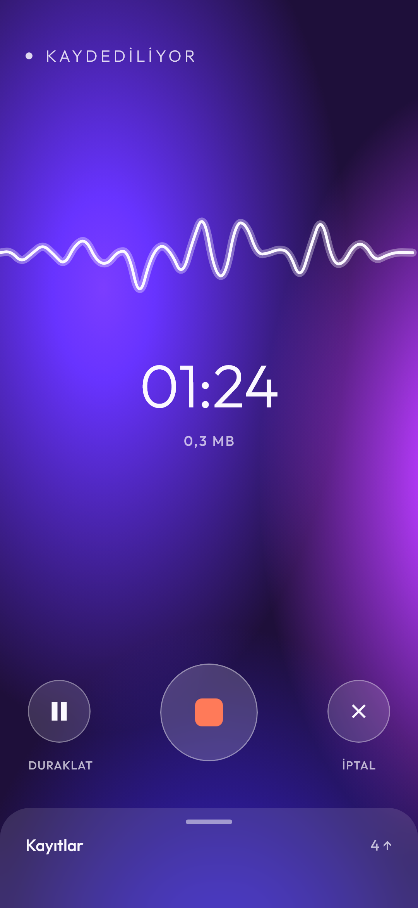
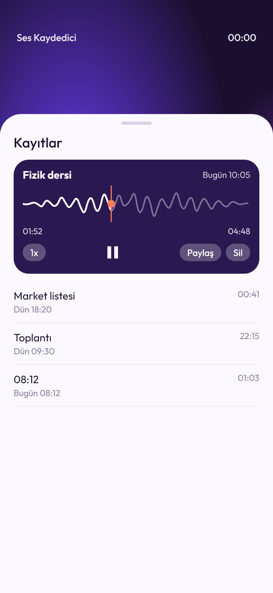
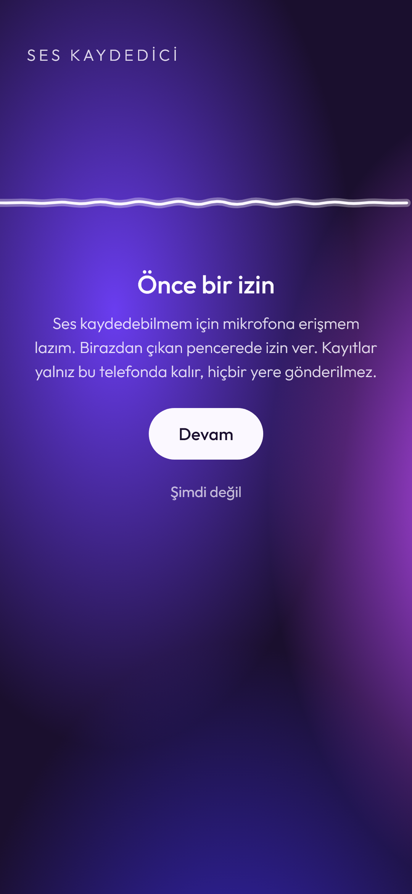

# Ses Kaydedici
### Part 11 · Her Hafta 1 Uygulama

Fikrini, dersi ya da toplantıyı hızlıca kaydetmek isteyen biri için tek
düğmeli, internetsiz bir ses kaydedici.

**Kod:** [github.com/MRGNSs11/weekly-flutter-apps-1](https://github.com/MRGNSs11/weekly-flutter-apps-1/tree/main/part11-ses-kaydedici) · **Yığın:** Flutter, record, just_audio, Drift, share_plus, Kotlin (ön plan servisi)

---

## 01 — Ne yaptım

Büyük düğmeye basınca kayıt başlıyor: ses tek bir beyaz çizgi olarak titriyor,
arkadaki mor bulut hızlanıyor, süre ve dosya boyu akıyor. Duraklatılabiliyor,
iptal edilebiliyor. Ekran kapalıyken kayıt sürüyor; bildirimden de
durdurulabiliyor. Kayıtlar alttan çekilen sayfada. Dinlerken dalgaya dokunup
istediğin yere atlanıyor, hız 1,5x ya da 2x yapılabiliyor. Kayıtlar yeniden
adlandırılıyor, paylaşılıyor, silinince 5 saniye geri alınabiliyor.

## 02 — Neyi YAPMADIM

- Kırpma ve sessizliği atlama
- Yazıya dökme
- Bulut yedek
- iOS

Bu haftanın konusu kayıt anıydı: mikrofon, canlı ses seviyesi ve ekran
kapalıyken çalışmak. Kırpma bir ses düzenleyici işi, ayrı bir uygulama olurdu.

## 03 — Bu hafta gösterdiğim teknik yetenek

**Mikrofon kaydı ve ekran kapalıyken çalışma.** Android, ekran kapanınca
uygulamanın mikrofonu kullanmasına ancak mikrofon tipinde bir ön plan servisi
varsa izin veriyor. Kayıt paketi bu servisi kurmuyor; onu Kotlin'de kendim
yazdım ([`KayitServisi.kt`](android/app/src/main/kotlin/com/omergunes/ses_kaydedici/KayitServisi.kt)).
Servis "Kaydediliyor" bildirimini tutuyor, bildirimdeki Durdur düğmesi kanal
üzerinden Dart'taki kaydı bitiriyor. Telefon gelince mikrofon duraklıyor,
ekran da "Duraklatıldı"ya geçiyor.

## 04 — Aldığım karar

**Neden dalgayı ses dosyasından çözmedim?**

Dinleme ekranındaki dalga genelde ses dosyası çözülerek çiziliyor. Bunu yapan
hazır paketin Android'de açık ve ciddi hataları vardı: kayıt bitmiyor, dosya
bozuluyor, süre iki katı çıkıyor.

Ben dalgayı kayıt sırasında topladım. Kayıt paketi 50 ms'de bir ses seviyesini
veriyor; her biri 0..1'e çevrilip bir listeye ekleniyor. Kayıt bitince liste
örnek başına 1 baytla veritabanına yazılıyor (bir saat ≈ 72 KB). Oynatıcı
dalgayı bu listeden çiziyor; ekrana sığdırırken her parçanın en yüksek değeri
alınıyor ki kısa sesler kaybolmasın. Dosya hiç çözülmüyor, dalga anında hazır.
Bedeli: uygulama dışında kaydedilmiş bir dosyanın dalgası yok; bu uygulama
zaten yalnız kendi kayıtlarını gösteriyor.

## 05 — Nasıl doğruladım

80 test: hesaplar (23), kayıt kontrolü (20), oynatıcı ve liste (13), kayıtlar
sayfası (10), veritabanı (8), kayıt ekranı (6). Mikrofon, hoparlör ve Android
servisi soyut; testlerde sahteleri kullanılıyor. Bir test, kısa bir ses
patlamasının dalgayı sıkıştırınca kaybolmadığını; bir başkası dalgaya
dokunulan yerin kaydın doğru saniyesine gittiğini sınıyor.

Ekran kapalıyken kaydı ve bildirimi testler göremiyor. Kodlamaya
başlamadan önce tek ekranlık bir deneme uygulamasıyla bunları gerçek telefonda
(Samsung, Android 16) denedim: ekran kapalıyken kayıt, Opus dosyasının
çalması, sarma ve hız.

## 06 — Ne öğrendim

**Paketin kaynağını okumak, belgesini okumaktan çok şey söylüyor.** Deneme
uygulamasından önce kayıt paketinin Android kodunu okudum. Belgede yazmayan
iki şey çıktı: Opus kaydı Android 10 ister (en düşük sürümü yükselttim) ve
telefon gelince kayıt kendiliğinden devam etmez, duraklar. İkincisini ekrana
"Duraklatıldı" olarak yansıttım; bilmeseydim kullanıcı kaydın sürdüğünü sanardı.

---
Bu, her hafta bir mobil uygulama bitirdiğim serinin 11. uygulaması.
Diğerleri: [github.com/MRGNSs11/weekly-flutter-apps-1](https://github.com/MRGNSs11/weekly-flutter-apps-1)
